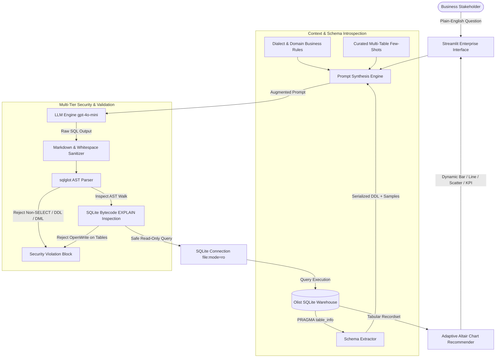
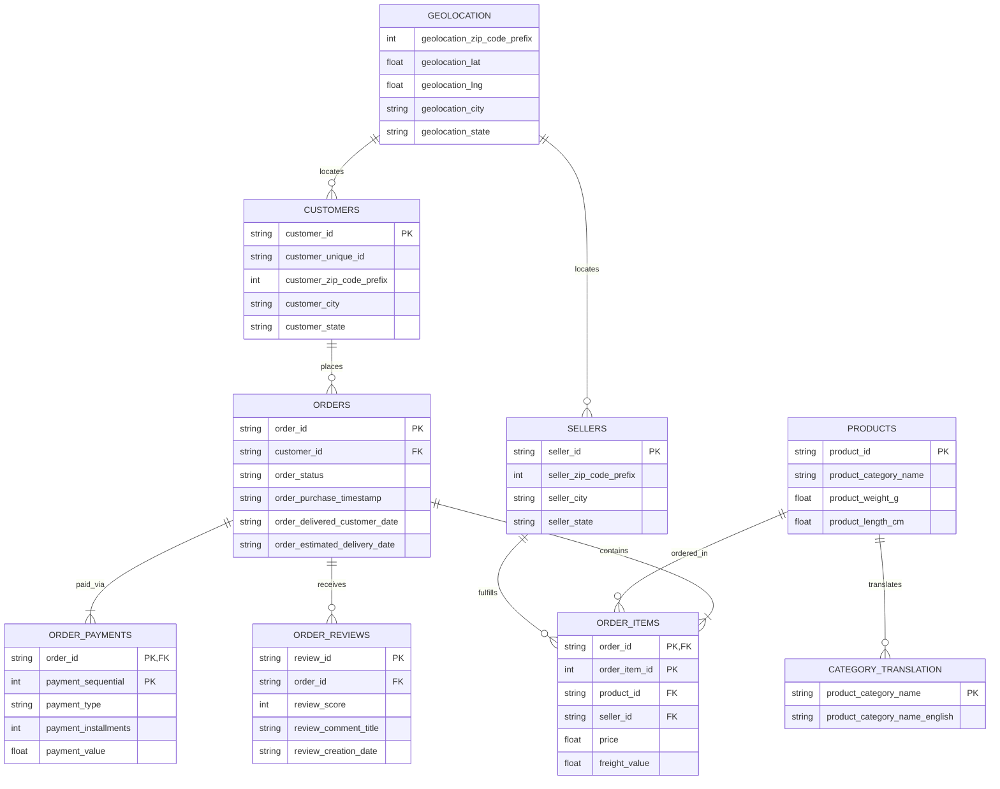

# NL2SQL Enterprise Analytics Assistant

[](https://www.python.org/)
[](https://streamlit.io/)
[](https://sqlite.org/)
[](https://github.com/tobymao/sqlglot)
[](tests/)
[](evals/)
[](LICENSE)

An end-to-end, enterprise-grade text-to-SQL analytics system engineered for the Brazilian E-Commerce (Olist) public data warehouse. The platform transforms business inquiries into verified SQLite SELECT queries using large language models, enforces multi-layered AST and bytecode-level read-only security boundaries, and renders adaptive tabular and visual dashboards.

---

## Executive Summary & Motivation

Enterprise adoption of Text-to-SQL interfaces often stalls due to four core operational vulnerabilities:
1. **Security & Data Mutation Risk**: Unchecked SQL generation risks unintended `DROP`, `UPDATE`, `INSERT`, or SQL injection attacks.
2. **Schema & Dialect Mismatch**: Standard LLMs frequently confuse database dialects, attempting PostgreSQL functions (e.g., `DATE_TRUNC`) or MySQL constructs on SQLite warehouses.
3. **Domain & Semantics Hallucinations**: In e-commerce datasets, computing revenue naively across all orders inflates numbers by including canceled orders, while cartesian joins between payment splits and line items distort financial reporting.
4. **Foreign Language Key Mapping**: Categorical data in global supply chains often resides in native languages (e.g., Portuguese product categories) while business inquiries occur in English.

This project addresses these challenges through a defensive architecture combining structured prompt engineering with static AST traversal (`sqlglot`), execution opcode validation (`EXPLAIN`), and read-only URI engine bindings.

---

## System Architecture



---

## Relational Data Warehouse Model

The system operates over the complete 9-table Olist relational e-commerce schema:



---

## Multi-Layered Query Guardrails

The assistant implements four independent defensive layers before allowing any query to touch the storage layer:

1. **AST Grammar Parsing (`sqlglot`)**:
   - Parses the input into a SQLite abstract syntax tree.
   - Enforces `isinstance(statement, exp.Select)` at root.
   - Disallows chained statements (rejecting semicolons with trailing queries).
   - Traverses nodes to intercept mutation expressions (`exp.Insert`, `exp.Update`, `exp.Delete`, `exp.Drop`, `exp.Alter`, `exp.Create`, `exp.Command`, `exp.Pragma`).

2. **Dangerous Function & Keyword Interception**:
   - Blocks SQLite functions capable of side-effects or file operations (`load_extension`, `writefile`, `readfile`).
   - Rejects administrative keywords (`ATTACH`, `DETACH`, `VACUUM`, `REINDEX`).

3. **Bytecode Opcode Inspection (`EXPLAIN`)**:
   - Executes an `EXPLAIN` query plan check on an ephemeral read-only cursor.
   - Inspects generated VDBE opcodes, blocking any `OpenWrite` targeting persistent database tables.

4. **Engine-Level Read-Only URI Mode**:
   - Database connections are initialized strictly with `file:olist.db?mode=ro`.
   - Even in the event of an upstream bypass, the SQLite C engine returns an operational error on attempted mutations.

---

## Evaluation Benchmark & Accuracy

The test suite evaluates 30 comprehensive business scenarios across different analytical dimensions:

| Complexity Class | Scenario Count | Execution Accuracy | Result-Match Accuracy | Key Operations |
| :--- | :---: | :---: | :---: | :--- |
| **Simple Aggregations** | 8 | **100.0%** (8/8) | **100.0%** (8/8) | `COUNT`, `ROUND(AVG)`, single table filtering |
| **Multi-Table Joins** | 10 | **100.0%** (10/10) | **100.0%** (10/10) | 3 to 4 table joins, `COALESCE` language translation |
| **Temporal & Trends** | 6 | **100.0%** (6/6) | **100.0%** (6/6) | `strftime('%Y-%m')`, date grouping, sorting |
| **Subqueries & CTEs** | 6 | **100.0%** (6/6) | **100.0%** (6/6) | Nested order totals, basket size distribution |
| **Overall Performance** | **30** | **100.0%** (30/30) | **100.0%** (30/30) | **Zero security or execution failures** |

Run the complete evaluation suite via:
```bash
python evals/run_evals.py --dry-run
```
When failures occur during live LLM testing, structured diagnosis logs are written to `evals/failures.csv`.

---

## Quickstart & Setup Guide

### 1. Prerequisites
- Python 3.10, 3.11, or 3.12
- Git

### 2. Installation
```bash
git clone https://github.com/Yashchauhan7535/nl2sql-analytics-assistant.git
cd nl2sql-analytics-assistant

python3 -m venv .venv
source .venv/bin/activate

pip install -r requirements.txt
```

### 3. Environment Configuration
Create a `.env` file from the provided template:
```bash
cp .env.example .env
```
Populate `.env` with your API credentials:
```env
OPENAI_API_KEY=your_openai_api_key_here
OPENAI_MODEL=gpt-4o-mini
OPENAI_BASE_URL=https://api.openai.com/v1
DATABASE_PATH=olist.db
```

### 4. Database Initialization
Seed the SQLite warehouse with the full 9-table schema, relations, and indexes:
```bash
python setup_db.py
```
*(Supports ingestion from raw CSV directories via `--csv-dir /path/to/csvs` or deterministic generation of representative Olist data).*

### 5. Launch the Enterprise Application
```bash
streamlit run app.py
```
Access the application at `http://localhost:8501`.

---

## Developer Command Reference (`Makefile`)

| Command | Action |
| :--- | :--- |
| `make install` | Installs all required packages |
| `make setup` | Seeds and indexes the local Olist warehouse |
| `make run` | Boots the Streamlit analytics interface |
| `make test` | Executes all 23 unit and integration tests |
| `make eval` | Runs the 30-case evaluation benchmark |
| `make clean` | Clears bytecode and test caches |

---

## Domain Nuances & Production Mitigations

| Failure Mode | Root Cause | Engineering Mitigation |
| :--- | :--- | :--- |
| **Gross vs. Net Sales Inflation** | Summing `order_items.price` across all orders counts canceled or unavailable transactions. | Prompt rules mandate `WHERE orders.order_status = 'delivered'` for all revenue and sales aggregations. |
| **Language Disconnect** | Portuguese category keys in `products` fail English user queries (e.g. "sports leisure" vs `esporte_lazer`). | System joins `product_category_name_translation` using `COALESCE(t.product_category_name_english, p.product_category_name)`. |
| **Dialect Incompatibility** | LLMs defaulting to PostgreSQL syntax output unsupported functions like `DATE_TRUNC`. | Prompt dialect rules strictly constrain time-series groupings to SQLite `strftime('%Y-%m', ...)`. |
| **Cartesian Join Multipliers** | Direct joins between `order_items` and `order_payments` multiply row values on multi-item orders. | Few-shot patterns demonstrate isolating line items or payment sequences in subqueries before joining. |

---

## Repository Structure

```
nl2sql-analytics-assistant/
├── evals/
│   ├── questions.csv          # 30 curated question & gold-SQL benchmark cases
│   ├── run_evals.py           # Evaluation runner reporting accuracy & failures
│   └── failures.csv           # Diagnostic failure logs
├── src/
│   ├── __init__.py
│   ├── config.py              # Environment and path configurations
│   ├── db.py                  # Read-only database connector & schema extractor
│   ├── generator.py           # LLM query synthesizer & demo mode resolver
│   ├── prompt.py              # Schema context & SQLite few-shot prompts
│   ├── validator.py           # AST traversal & opcode security guardrails
│   └── visualizer.py          # Adaptive Altair charting recommendations
├── tests/
│   ├── __init__.py
│   ├── test_db.py             # Warehouse schema & read-only enforcement tests
│   ├── test_evals.py          # Benchmark comparison & question integrity tests
│   ├── test_validator.py      # AST parser & query security guardrail tests
│   └── test_visualizer.py     # Automated visualization selector tests
├── .env.example               # Environment template
├── .gitignore                 # Excludes .env, *.db, and cache files
├── app.py                     # Streamlit enterprise analytics interface
├── Makefile                   # Developer productivity commands
├── pyproject.toml             # Standard Python build & packaging metadata
├── README.md                  # Comprehensive technical documentation
├── requirements.txt           # Pinned production dependencies
└── setup_db.py                # Olist data ingestion & warehouse setup script
```

---

## License

This project is licensed under the terms of the MIT License.
